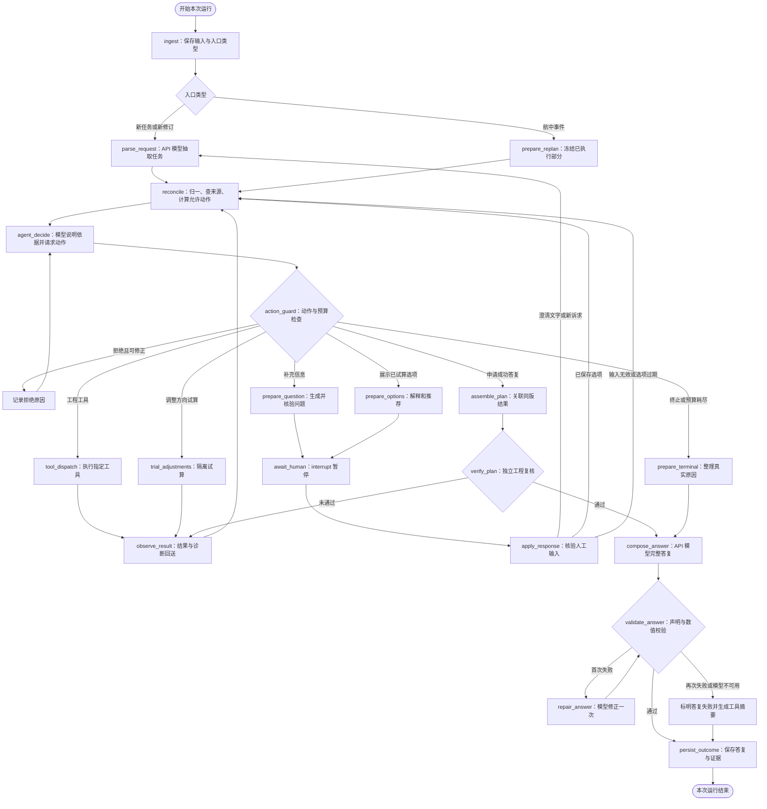
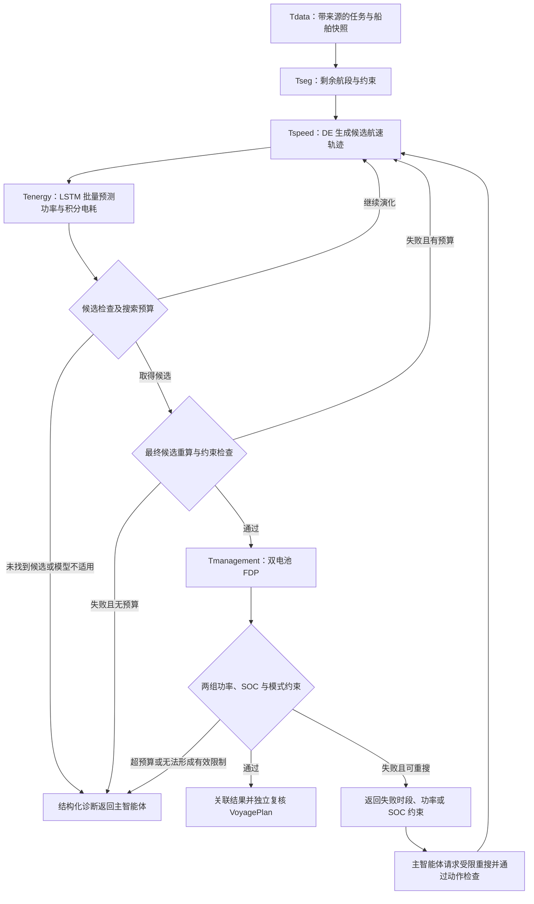
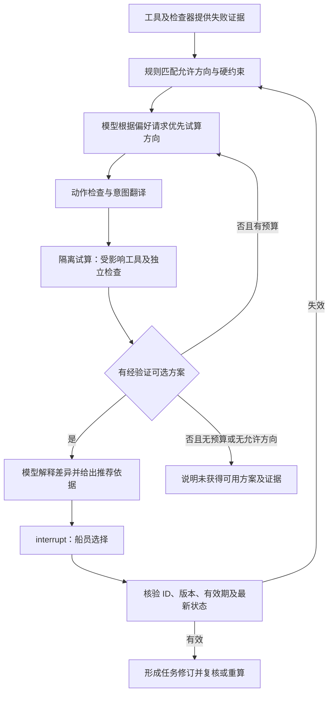
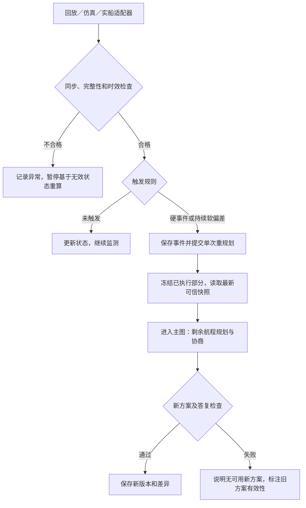

# 智行合一智能体：LangGraph 图结构与运行机制计划

## 2026-10-21 实现进度：分航段环境与网页联合验收

本日补充第二轮边界验收：十种固定航次通过与网页相同的后端运行时及真实模型测试，首轮 6/10、串行整批重测 7/10；原始失败均保留，受影响项修复重测后最终集合为 6 项可行、4 项明确拒绝。修复复核轨迹导出时间轴、低于规划下限的入口校验、Windows 需求工件长路径、默认节能目标被模型改写，以及长航线有界分配搜索的可行路径恢复。恢复仅在原 FDP 未完成后尝试仓库已有状态机，继续独立复核，明确披露不宣称最优。浏览器本轮因审批额度限制未做视觉验收，未将这些后端测试标为网页测试。详见 [第二轮十航次边界验收](../../验收/第二轮十航次边界验收_2026-10-21/验收报告.md)。

环境快照由 Tdata 加载集中具名配置，Tseg 绑定物理段、方向、水流、载况系数和中间船闸等待。Tspeed 以对地航速生成轨迹，内部解析 Tenergy 以对水航速计算推进功率；同一需求交给 FDP，发布前独立重放环境功率和双电池 SOC。工件记录环境版本及哈希，接口拒绝错配。

增加风/航道阻力系数和载况敏感性，参数仍为软件仿真假设。已取消随机速度扰动。真实 LSTM 保留短时预测范围，未套用解析模型的环境修正。

原版网页布局沿用，在公开决策过程内展开环境与双航速依据。通过实际浏览器提交十种航次，真实模型 `deepseek-v4-pro` 选择工具动作；8 项生成复核通过方案，2 项正确返回电量/时间约束。修复明确航次被误识别为独立预测，以及明确港口/船闸被模型改写或漏填的问题。

当前代码位于独立环境分支，验收为本机执行。输入、数值、逐项事件引用及复现方法见 [十次网页验收报告](../../验收/分航段环境与十次网页验收_2026-10-21/验收报告.md)。以下 2026-10-16 小节为当时实现范围。

## 2026-10-16 实现进度：研究跑通版

本节记录实际范围，后文保留完整目标架构。独立审查分支已接入真实 API 原生工具调用的主循环，入口 research/agent/runtime.py。
正常规划按 Tdata、Tseg、Tspeed（内部预测）、Tmanagement 依赖执行，独立复核后发布研究结果。
增加项目资料检索、任务结果查询比较、单位时间计算三类辅助工具，同样由模型选择并记录。
人工澄清使用 interrupt；SQLite 检查点、事件与哈希 JSON 工件支持刷新读取和重启后恢复等待。
网页主任务入口与 CLI 使用同一 LangGraph 研究运行时；原独立研究面板已撤下，v1 演示接口暂保留供兼容测试，不在当前网页调用。本机主页面已真实调用 deepseek-v4-pro，模拟模型仅用于自动化测试。
主结果区直接显示模型答复、可核验数值与工具状态；工具事件、模型公开决策依据、原始 API 响应及来源按需展开。页面刷新后从持久化任务与事件恢复。
解析功率情景中的载况作为具名软件仿真假设记录，当前功率系数不随载况变化；这不代表该载况已有实船标定。资料问答可引用已检索文档中的版本号与文件路径，规划计算数字仍只由工具占位符插入。
情景、双电池与预算集中在 configs/research_agent.json；完整航程用解析后端，LSTM 单独验证短轨迹与域外拒绝。
有界 FDP 反馈重搜已实现；完整协商试算、途中充电、持续监测、长时 LSTM 与分布式部署仍未实现。
重启可恢复等待，运行中计算被中止时记录失败，不宣称自动接续。
详见 [智能体真实调用使用与验收](../../验收/智能体真实调用使用与验收_2026-10-16.md)。

> 更新日期：2026-10-14。面向最终论文研究系统，依据已确认的《项目论文方案稿》完善。
> 本文是目标架构，不代表现有代码已经实现。已确认的定位与工具方法继续沿用；节点名称、字段、状态枚举、接口路径和预算参数属于待联调冻结的设计。
> 导师论文指导数值工具，不规定智能体框架。本次替换旧图计划；旧文档中的“已定稿”不能覆盖后续已确认的方案。

## 1. 定位与设计原则

系统由 API 大语言模型、LangGraph 运行时、五个工程工具、规则校验、人工选择及数据存储共同构成。API 模型承担自然语言理解、受约束的动作选择、结果解释和完整正式答复；Tenergy 的 LSTM 承担数值预测，两者不同。

采用**单个主智能体决策循环，配合数值计算、协商试算和答复校验流程**。一个节点是一个运行步骤，不等于一个独立智能体；五个工具不需要各自再配置语言模型。

图结构必须能回答：模型依据什么请求了什么动作；运行时为什么允许或拒绝；工具使用什么数据实际算了什么；异常和人工等待走哪条路径；结果怎样保存与查证；任务中断后怎样继续。

模型在当前允许的动作中选择下一步并说明依据，运行时执行实际路由、依赖和硬约束检查。到达时间、出发安排等取舍由船员确认。模型不能自行修改安全 SOC 下限、法定限速和设备功率边界，不能跳过双电池检查宣布成功。展示的模型依据是明确生成的公开摘要，不声称是模型内部完整思维链。

## 2. GitHub 项目学习与取舍

以下为 2026-10-14 查阅的官方仓库及文档。借鉴具体机制，不移植它们的研究效果或可靠性结论。链接指向查阅时的主分支，实施时记录采用版本。

| 参考来源 | 查阅到的机制 | 本项目采用方式 |
|---|---|---|
| [react-agent / graph.py](https://github.com/langchain-ai/react-agent/blob/main/src/react_agent/graph.py) | 模型绑定工具，工具执行后返回模型，条件边读取工具调用 | 使用模型—动作检查—工具—模型循环，增加阶段准入和明确终止条件；不能只因模型没有调用工具就判成功 |
| [open_deep_research / deep_researcher.py](https://github.com/langchain-ai/open_deep_research/blob/main/src/open_deep_research/deep_researcher.py) | 结构化澄清、任务说明、模型工具循环、独立报告与迭代预算 | 借鉴阶段分离及结果回送；不引入并行研究员架构。该[仓库](https://github.com/langchain-ai/open_deep_research)已于 2026-08-21 归档，作为架构案例，不作为持续维护依赖 |
| [Agent Chat UI / tool-calls.tsx](https://github.com/langchain-ai/agent-chat-ui/blob/main/src/components/thread/messages/tool-calls.tsx) | 工具名称、调用 ID、参数和可展开结果 | 建立可展开调用卡片，补充状态、版本、来源和证据跳转 |
| [Agent Chat UI / Stream.tsx](https://github.com/langchain-ai/agent-chat-ui/blob/main/src/providers/Stream.tsx) | useStream、线程 ID、历史及自定义事件处理 | 借鉴过程同步展示；现有 FastAPI 先接自有事件流，其 SDK 不能直接假定兼容现有接口 |
| [LangGraph Interrupts](https://docs.langchain.com/oss/python/langgraph/interrupts) | interrupt 暂停、同一线程恢复、中断节点从头执行 | 独立等待节点；问题准备和试算移到节点外，恢复幂等 |
| [Streaming](https://docs.langchain.com/oss/python/langgraph/streaming) 和 [Persistence](https://docs.langchain.com/oss/python/langgraph/persistence) | 状态、消息、自定义进度流及检查点 | 检查点恢复现场，业务事件库审查历史，工件库存大数组；先落库再推送 |

当前项目声明 `langgraph==1.2.11`、Python `>=3.10`。实施前核对实际环境并冻结版本，不未经验证复制文档中的新 API；继续兼容 Python 3.10 时，异步事件采用显式注入的记录器，避免依赖更高 Python 版本才支持的上下文传播行为。

## 3. 主图与数值依赖图

### 3.1 主图

`tool_dispatch` 分派至具体工程工具节点。固定的是合法转移关系，具体请求哪个允许动作来自模型。所有节点通过统一记录器产生事件。

API／工具异常走统一处理：可恢复错误有限重试；结构化错误进入 `observe_result`；无法恢复的故障进入 `prepare_terminal`。解析、决策、问题生成和报告请求同样适用。API 全部不可用时直接给出明确标识的系统说明，不声称产生了模型答复。

等待船员时停在 `interrupt`，状态为 `waiting_human`，不以 END 代替等待。END 只结束本次运行。航中持续监测由独立服务负责，不让主图常驻无限轮询。

### 3.2 五工具数值依赖

下图只表达计算依赖。主图中 Tdata、Tseg、Tspeed、Tmanagement 各自完成后返回模型决策和动作检查；Tspeed 内部候选评价由算法执行。

Tenergy 可单独用于已知轨迹检查，但不再要求先生成固定速度能耗表再交 Tspeed。DE 的候选生成、变异、筛选和批量评价不交给 API 模型；每次 LSTM 批量调用单独记录并关联父级 Tspeed。

Tmanagement 首版按任务书复现导师三模式 FDP，双启模式分配遵循任务书规定，更自由的分配比例属于扩展实验。离散模型中未找到路径须记录网格和剪枝条件，不能据此宣称实际船舶在所有控制策略下均无解。

## 4. 节点职责

| 节点 | 执行者 | 输入、输出与处理边界 |
|---|---|---|
| ingest | 运行时 | 原始消息和请求 ID → task/run/thread 标识、消息引用 |
| parse_request | API 模型 | 消息、当前时间、已有任务、实体候选 → schema 草稿、原文依据和歧义，不直接覆盖事实 |
| prepare_replan | 规则 | 触发事件、执行记录、可信快照 → 剩余任务和父方案引用 |
| reconcile | 规则 | 草稿或工具观察 → 规范请求、缺项、冲突、有效结果索引和允许动作 |
| agent_decide | API 模型 | 任务、状态、工具摘要、允许动作 → 下一动作和公开依据 |
| action_guard | 规则 | 检查动作、前置版本、参数、权限和预算；拒绝也保存记录 |
| tool_dispatch | 运行时 | 把已批准请求交具体工具节点；不把模型文字当作工具结果 |
| Tdata | 工具 | 获取船舶、双电池、环境和质量信息；缺项或冲突显式返回 |
| Tseg | 工具 | 路线和约束 → 航段、断点及来源；不在内部自动决定补能 |
| Tenergy | LSTM 工具 | 历史窗口、候选未来轨迹、环境情景 → 功率、电耗及适用性 |
| Tspeed | DE 工具 | 航段、约束、预测器和反馈限制 → 航速、预测、检查和诊断 |
| Tmanagement | FDP 工具 | 同版功率需求、两组参数及初态 → 功率、SOC、模式、成本和诊断 |
| observe_result | 运行时和规则 | 实际返回或异常 → ToolMessage、工件引用、诊断和有效性，回送模型 |
| prepare_question | API 模型和规则 | 规则指定的缺项及真实候选 → 经检查的问题和 pending ID |
| trial_adjustments | 规则和工具 | 允许方向和范围 → 隔离完整试算，不修改当前已确认请求 |
| prepare_options | API 模型和规则 | 已试算选项 → 有证据的解释和推荐，等船员选择 |
| await_human | LangGraph | 已持久化待答事项 → interrupt，只接收恢复值 |
| apply_response | 规则 | 回答、ID和版本 → 输入修订；过期选择拒绝，新诉求回解析 |
| assemble_plan | 运行时 | 关联同版结果与明示派生计算 → VoyagePlan |
| verify_plan | 独立检查器 | 方案和轨迹 → 工程检查记录，失败回诊断 |
| prepare_terminal | 规则 | 取消、无可用方案、预算耗尽或故障 → 诊断证据包 |
| compose_answer / repair_answer | API 模型 | 已核验证据 → 完整原始正文与声明引用，原文先保存 |
| validate_answer | 规则 | 正文及引用 → 数值、单位、版本和结论检查 |
| persist_outcome | 运行时 | 答复、校验及证据 → 可查询终态，原子更新结果指针 |

统一执行器负责超时、重试、事件和异常格式。工具内部仍是普通 Python 函数或服务，注册后由运行时响应模型的结构化请求调用。试算、汇总和校验属于编排组件，不另计为第六个工程工具。

## 5. 模型解析、动作协议与路由准入

### 5.1 解析与自动取数

API 模型输出起终点原文、候选实体、出发和到达时间、停靠需求、偏好及逐项原文依据。缺失值为 null，不自行补 SOC、容量或限速。规则执行单位转换、相对时间归一及实体核验。

别名库、错别字／拼音相近检索提供真实路线实体；唯一且依据充分的匹配可归一，多候选时追问。模型置信度不能证明地点存在或参数真实。

已知船舶身份时可先请求 Tdata，再决定哪些信息需要船员补充。起点可取当前位置，速度、SOC1/SOC2、设备状态可自动读取；数据同时检查来源、时间、质量及测量位置。未确认语义的历史 capacity 不作为实测 SOC，仿真假设必须命名。用户输入与事实冲突时显式处理，不静默以任一方覆盖。

规则确定必须补充的字段、真实候选及允许问题范围；模型组织问题措辞、顺序与解释，问题中的数值选项必须来自有效数据或试算。不能因为字段未在用户原话出现就反复追问已有传感器数据。

### 5.2 动作协议

每轮一个动作，至少包含 `action_id, action_type, arguments, expected_request_revision, expected_plan_version, evidence_refs, public_rationale`。版本和引用由后端核验，public_rationale 是模型主动输出的公开依据。

优先采用所选 API 的工具调用能力承载动作，结构化输出承载解析和声明。统一模型适配器保存 API 可见响应、请求 ID、模型标识、耗时及可用的用量信息，密钥不进入日志。仅支持文本的提供者可走 JSON 加 schema 校验的显式兼容模式，单独验证可靠性，不能称作原生工具调用。

每个原生 tool_call_id 对应一条 ToolMessage，包括拒绝、超时和失败。请求同时执行有依赖的多个工具时要求拆分，不能直接并行。消息 reducer 按稳定消息 ID 合并，恢复时不重复添加同一调用结果。

| 动作 | 允许条件 | 路由与限制 |
|---|---|---|
| fetch_data | 已识别船舶／来源，或需要刷新字段 | Tdata；缺任务目标不阻止读取可得状态 |
| ask_clarification | 存在规则认可的缺项、歧义或冲突 | 问题准备 → 等待；先利用可得自动数据 |
| segment_route | 起终点和通航数据足以建立路线 | Tseg；不能编造路线实体 |
| predict_energy | 有合法轨迹及必需特征 | Tenergy 单项检查，不替代完整规划 |
| optimize_speed | 有有效航段、适用预测器和同版约束 | Tspeed，内部调用 Tenergy；反馈限制须有来源 |
| manage_energy | 有有效入选功率时序和两组参数 | Tmanagement；版本不符时拒绝 |
| trial_adjustment | 有可处理诊断、允许方向和预算 | 意图翻译器形成修改，隔离试算 |
| present_options | 存在可查询且未过期的试算选项 | 模型解释 → 等待船员 |
| prepare_final | 速度与双电池结果有效且初步通过 | 汇总 → 独立复核 → 答复 |
| finish_without_plan | 用户取消、已诊断无可用方案或预算耗尽等 | 整理原因 → 说明；不能无故放弃必要步骤 |

reconcile 按状态计算允许动作；模型选择获取什么补充证据、先试算哪个方向、如何解释，运行时核验并路由。不再沿用“LLM 不参与路由”的旧描述。

资料、历史日志与工具文本按数据处理，不能改变权限和安全约束。上下文只放必要摘要和引用，原始历史及大型时序保存为可查询工件。

## 6. State、状态分类与版本

### 6.1 共享状态字段

以下为待转成类型定义的字段设计。messages 使用消息 reducer；其他字段按明确的替换或追加规则更新，不把整个 State 变成无限增长列表。

| 分组 | 拟定字段 | 更新语义 |
|---|---|---|
| 标识 | task_id, thread_id, run_id, entry_type, schema_version | task 为航行任务，thread 定位检查点，run 为一次执行／恢复 |
| 对话 | messages, raw_input_refs, model_response_refs | 消息按 ID 合并；原文另存，不随上下文压缩删除 |
| 请求 | request_draft, request, request_revision, entity_candidates, missing_fields, conflicts | 草稿核验后形成新修订，保留旧修订 |
| 数据 | snapshot_ref, snapshot_time, source_mode, source_refs, quality_flags | 快照不可变；字段可分别来自 replay/simulation/live/config/user |
| 工具 | segment_ref, energy_refs, optimization_ref, management_ref, valid_result_index | 活跃引用可替换，工件不可覆盖；绑定请求、快照和配置哈希 |
| 决策 | allowed_actions, pending_action, last_observation, diagnostic_refs | 每轮重算，不信任客户端给出的允许动作 |
| 人工 | pending_human, option_refs, selected_option_id, decision_history_refs | 待答事项有 ID、有效期、依据版本，只有效应用一次 |
| 方案 | plan_version, parent_plan_ref, candidate_plan_ref, verified_plan_ref, active_plan_ref | 候选、验证与采用状态分开，新候选不覆盖在用方案 |
| 执行 | executed_prefix_ref, latest_execution_ref, trigger_event_ref | 执行历史追加，已走部分不可优化 |
| 控制 | phase, lifecycle_status, outcome_code, budgets, retry_counters, cancellation_requested | 生命周期、业务结论和各种预算分开 |
| 答复 | answer_draft_refs, answer_validation_ref, final_answer_ref, answer_status | 原始草稿和最终版本共存，不覆盖失败记录 |
| 观测 | last_event_seq, current_node, checkpoint_ref | 指向外部记录，不内嵌完整事件历史 |

检查点保存恢复需要的状态与引用。大数组、原始响应、全文与事件另存工件或业务库，使用稳定 ID、内容哈希和来源引用。

### 6.2 三类状态

| 维度 | 建议枚举 | 用途 |
|---|---|---|
| lifecycle_status | queued / running / waiting_human / completed / failed / cancelled | 图是否运行、等待或结束 |
| outcome_code | pending / needs_input / data_invalid / model_out_of_domain / search_unresolved / infeasible_under_assumptions / tool_error / no_usable_plan / feasible_plan / user_cancelled | 数据及工程结论 |
| answer_status | not_started / draft / validating / accepted / rejected / unavailable | 模型答复是否可正式展示 |

例如数值方案可行但正文两次写错，保存 feasible_plan 与 rejected，另展示工具摘要。工具超时不能写成电量不足。infeasible_under_assumptions 必须附约束模型、证据和适用范围，不能用一个 feasible 布尔值承担全部诊断。

### 6.3 依赖失效

- 起终点、航线或停靠改变：重新分段及重算所有下游结果。
- 到达期限改变：重算速度、能耗和双电池；影响时间锚点或闸口窗口时也重新分段。
- SOC 或设备功率改变：刷新快照、速度预算及双电池；必要时重分段。
- 水文气象改变：刷新预测情景；断点激活条件变化时重分段。
- 仅修改答复语言风格：可复用仍有效的已验证方案，生成新答复版本。

复用时核验依赖哈希，plan_version 相同不等于输入相同。试算另加 trial_id，不能以工具名称为唯一键覆盖多轮结果。

## 7. 诊断、协商与人工恢复

### 7.1 分环节分类

| 环节 | 诊断类型 | 处理与模型作用 |
|---|---|---|
| 解析 | 目标缺失、地名歧义、时间冲突 | 查询候选或追问；模型理解语言并组织问题 |
| Tdata | 过期、冲突、关键参数缺失 | 刷新或补充；模型解释所需信息，不虚构读数 |
| Tseg | 路线不可达、限航、停靠或窗口冲突 | 有来源时试算任务安排，模型按偏好排序 |
| Tenergy | 缺特征、窗口断裂、超适用域 | 补数据、限域或说明不适用，不称电量不足 |
| Tspeed | 时间／限速／功率／预算冲突，或未找到可行个体 | 有界重搜、独立诊断或协商；不称全局无解 |
| Tmanagement | 单组／总功率、SOC、模式、离散路径失败 | 反馈 Tspeed 或协商，解释失败时段和约束 |
| 工具执行 | 超时、网络异常、工件缺失、非法返回 | 有限重试后记工具故障 |
| 工程复核 | 版本、计量边界、时序或守恒不一致 | 失效相关结果并重算，不靠改写报告绕过 |
| 答复复核 | 数字、单位、引用、可行性表述不一致 | 修正一次，仍失败则明确标识 |

诊断至少包含 `stage, code, scope, field_ref, observed_value, limit_value, unit, time_or_segment, source_refs, retryable, allowed_adjustments`。未知数值为空并注明原因，不编造最小电量缺口。DE 未找到可行解不证明无解，FDP 离散状态失败也需说明范围。

### 7.2 协商图

类别与允许动作来自版本化规则表；模型可决定试算顺序和解释方式。数值调整范围来自任务约束、来源数据及工具试算，不由模型凭空承诺可行时间或补能量。

首版可调整方向包括经船员同意改变到达期限、出发安排，以及具备核实条件的补能停靠。规则表只开放实际具备数据和计算支持的方向。补能需核验位置、设施、功率／效率、时长、通航窗口及双电池状态更新，不能只按最近点自动插入。

Tseg 只在确定的候选停靠任务下形成断点，补能闭环放在外层完整试算。删除旧稿“Tseg 内部自动补能”“统一 25% 触发”“最多 3 次即判无解”。任务期望余量与硬性 SOC 下限未区分前，不开放 accept_lower_soc。

试算使用输入副本和 trial_id，不覆盖当前确认请求。可执行选项必须通过双电池和独立检查；失败试算可展开查证，不能列为可行选项。用户选择后重新核验时效；重算导致关键代价变化时重新确认。

### 7.3 暂停与恢复

问题和选项先保存，再进入只负责等待的节点。恢复请求携带 `thread_id, pending_id, request_revision, plan_version, response_id`，选择题另带 option_id。自由文本回解析，不能直接变成任意数值补丁。

服务端校验标识、所属任务、版本和快照时效后，以同一线程的 Command(resume=...) 恢复；相同 response_id 返回已处理结果。失效选项重新生成待答事项。等待期间新硬事件先使旧选项失效，取得该任务执行权后再处理，不能并发改同一状态。

LangGraph 恢复时会从中断节点开头重执行。因此问题生成、试算和写记录移到独立节点，等待节点仅使用已保存 payload，不现场重复调用模型或工具；宽泛异常捕获不能吞掉 interrupt。记录使用稳定 ID 去重。[实现依据](https://docs.langchain.com/oss/python/langgraph/interrupts)

## 8. 航中事件与重规划

### 8.1 事件入口

统一适配器接受历史回放、软件仿真和未来实船输入，逐字段附来源、时间与质量。仿真 SOC 不称实测 SOC；模型不能自行把缺失传感器值替换成仿真值。仿真器提供状态和事件，不替代五工具计算。

新限速、航段封闭和设备可用性变化等有依据的硬事件立即进入触发处理。预计到港、剩余能量等软偏差采用阈值、连续样本确认、滞环和最小重规划间隔；数值通过场景实验冻结，不因单条噪声反复重算。

1800 秒只作导师论文周期重算实验起点。研究比较固定周期、事件触发和组合策略的及时性、能耗、耗时和频次，不预设普适最优周期。

### 8.2 一致性与采用

冻结已完成航段、当前段已执行部分和已消耗能量，以最新位置、速度、两组 SOC 和剩余时间重算。保存父方案、触发原因、快照及差异。独立检查确认未优化历史，也未把剩余期限重置为原始全程期限。

同一任务仅一个活跃写入运行，使用数据库租约或版本比较更新，不能只依赖进程内锁。软事件可合并到最新快照，硬事件不因冷却被丢弃。求解期间更高优先级事件到来，在可取消边界终止旧求解；过期返回留存但不得发布为当前方案。

研究仿真是否自动采用新方案由实验策略配置；改变期限、停靠等任务取舍仍需协商。未来实船执行授权和设备控制另行设计，当前图输出规划建议。重算失败时保留旧计划供追溯，独立判断其当前有效性，不能包装成安全新计划。

## 9. 正式答复、工程复核与数值证据

### 9.1 VoyagePlan 与工程复核

assemble_plan 关联同版工具结果，逐字段保留调用和来源。需要汇总时记录公式、输入和单位，不创造工程结论。verify_plan 至少检查：

- 请求、快照、航段、预测模型、约束及双电池参数一致。
- 距离、时轴、等待／停靠、速度、加减速及期限满足约束。
- 电机侧、电池侧和辅助负载边界一致，损耗和等待能耗不漏计、不重复。
- 两组逐时功率平衡、SOC 转移、上下限和模式成立。
- 总能量和到达时间可从细项复算，重规划保持历史冻结。
- 数据质量、预测适用域与本次研究声明相符。

任一必要检查失败回诊断。求解器的 feasible 是输入证据，不替代独立检查，模型一句“建议谨慎”也不能绕过。

### 9.2 模型一手输出与数字锁定

API 模型依据验证后的证据包生成完整自然语言正文：任务理解、航速和双电池建议、理由、取舍、假设及适用范围。失败任务生成对应说明。保存原始 API 可见响应、正文、声明引用及每次修改，由后端提供正式版本。

建议协议为 answer_markdown 加 claims[]。工程声明带 `claim_id, text_span, source_ref, field_path, value, unit, plan_version`，支持点击数字跳转。正文仍由模型生成，声明表用于校验和追溯。

校验同时检查正文覆盖和声明表，不能只检查模型自己列出的 claims。日期、中文数量、区间、百分比、单位换算及比较结论需有处理规则；派生数字先由确定性组件生成有公式的字段。无法可靠映射的关键声明标记未通过，不以仅提取阿拉伯数字宣称理解所有语义。

独立规则核验数值、单位、版本、汇总和“满足期限／两组 SOC 达标”等表述。首版明确支持的工程声明类型，不声称验证全部开放自然语言；无依据的工程承诺不能进入正式成功答复。

首次错误要求模型修正一次，再次失败或模型不可用则保留失败正文、清楚标识，另提供有来源的工具摘要。数值方案可能仍有效，但摘要不能冒充模型原话。

流式正文只在“生成中的草稿”区域显示，校验通过才原子发布正式版本。前端不再用 operatorSummary() 生成模型最终答复。

## 10. 过程可见、持久化与接口

### 10.1 追加式事件

展示真实模型动作、公开依据、规则判定、工具过程及人工选择；不以预设动画或事后编写的解释冒充当时的模型过程。

| 字段组 | 内容 |
|---|---|
| 归属 | event_id, task_id, run_id, plan_version, trial_id, seq |
| 因果 | action_id, call_id, parent_call_id, causation_event_id |
| 执行 | actor, node, event_type, status, timestamp, duration_ms |
| 证据 | input_refs, output_refs, source_refs, public_summary, error_code |
| 复现 | model_version, tool_version, rule_version, config_hash, seed，不适用为空 |

seq 在 task 内递增，恢复沿用序列。工具事件覆盖 requested、rejected、started、progress、completed、failed、cancelled；缓存复用记 cache_hit。重试保留逻辑 call ID，另加 attempt ID。

每次 LSTM 批量调用有独立 call ID 和父级 Tspeed ID；候选数、版本和耗时可查。批内候选有索引、输入输出明细，以工件分页查看或导出。界面可折叠，不能只留下总调用次数。

### 10.2 三种存储

1. 检查点库：保存图状态和等待位置，支持服务重启恢复。
2. 事件库：保存已发生过程，按游标补读，不由 checkpoint 代替。
3. 工件库：保存时序、候选、方案、API 可见原始响应、正文和检查报告。

执行前保存稳定调用 ID 和 started；执行后先保存工件与完成记录，再给图引用。节点重放先查已完成结果，仅在输入版本一致时复用。若外部调用完成后、落库前崩溃且无法判断结果，记录不确定尝试；纯计算可有记录重算，不承诺所有外部调用严格恰好一次。

事件落库后再推送，可用事务性待推送表。事件与检查点不假定处于同一事务，恢复按稳定 ID 对账。正式结果发布采用版本比较，阻止过期运行覆盖。

### 10.3 拟定接口

| 接口 | 用途 |
|---|---|
| POST /api/tasks | 创建并立即返回 task/thread/run ID，后台开始 |
| GET /api/tasks/{task_id} | 节点、三类状态、等待事项、版本及末尾事件序号 |
| GET /api/tasks/{task_id}/events?after_seq=... | 分页补读事件 |
| GET /api/tasks/{task_id}/stream | SSE 推送已持久化事件，断线按序号续读 |
| POST /api/tasks/{task_id}/resume | 带版本及幂等 ID 的人工回答 |
| GET /api/calls/{call_id} | 单次调用、尝试和子调用 |
| GET /api/artifacts/{artifact_id} | 结果详情、分页或下载 |
| GET /api/tasks/{task_id}/answers/{version} | 正文、校验状态与声明引用 |
| POST /api/tasks/{task_id}/cancel | 请求取消，记录取消边界及终态 |

路径为设计建议，实现时兼容迁移现有恢复与查询接口。SSE 断线不等于取消计算。接口验证任务归属和访问权限，公开视图保留必要模型／工具标识用于追溯，过滤密钥等配置。

### 10.4 前端结构

- 主要结果：后端完整模型正式答复，附版本和校验状态；工具摘要独立标识。
- 可展开时间线：任务理解、取数、分段、航速与能耗、双电池、协商、检查和答复；展示输入、输出与依据。
- 状态面板：节点、正在执行的调用、缺项、待人工事项、失败原因及能否恢复。
- 证据跳转：正文声明 → 方案字段 → 工具调用 → 数据／参数来源。
- 版本比较：重规划事件、输入变化、方案差异及旧方案有效性。

借鉴 Agent Chat UI 的调用卡片，保留现有前端也可实现；整体迁移 Next.js 不是本架构成立的前提。

## 11. 有界循环与退出

| 预算 | 对象 | 超限行为 |
|---|---|---|
| max_agent_steps | 单次运行模型轮数 | 保存证据，说明预算耗尽 |
| max_invalid_actions | schema、越权及缺前置请求 | 结束无效循环，记模型动作失败 |
| max_tool_retries | 可重试执行错误 | 工具故障，不转换成工程不可行 |
| max_speed_management_cycles | DE—FDP 反馈重搜 | 协商或未获得可用方案 |
| max_trial_candidates / max_trial_walltime | 协商试算数量和耗时 | 展示已有有效选项或说明无可用选项 |
| max_human_rounds | 单次协商轮数 | 允许结束或新建任务修订，避免无限往返 |
| answer_repair_limit=1 | 正文内容修正 | 留存失败正文，单独工具摘要 |
| 触发冷却、事件合并和运行时限 | 航中重规划 | 软事件抑制抖动，硬事件保留并优先处理 |

除已确认的答复修正一次外，预算作为实验配置，按成本与成功率冻结。recursion limit 是最后保护，不替代业务终止条件。按输入、动作和诊断哈希检测无进展的重复请求。自动重搜、工具重试、协商和航中重规划不能继续共用一个 replan_count。

## 12. 当前差距与改造顺序

### 12.1 代码核对

| 位置 | 当前机制 | 目标 |
|---|---|---|
| core/request_parser.py | 规则和正则解析 | API 草稿加实体、单位、来源核验 |
| core/llm_layer.py | complete_text 文本补全为主 | 结构化动作、能力检查、原始响应保存 |
| core/orchestrator.py | TOOL_ORDER 固定顺序；Tspeed 失败协商；Tmanagement 后 finalize | 模型循环、动作检查、结果回送、FDP失败回路、独立成功门槛 |
| 当前算法及接口 | 合成能耗、有限候选、合并 SOC | LSTM 可调用预测器、DE、两组 FDP、统一口径 |
| core/workflow_runtime.py | 持久化 checkpoint 和恢复锁，主要等待完整结果 | 后台执行、事件工件存储、跨进程一致性 |
| core/report.py、core/value_lock.py | 程序报告与模型定性短说明、结构化数字检查 | 模型完整正文、声明覆盖与证据校验 |
| ui/web_server.py、ui/app.py | 最终 JSON、trace，已有恢复查询 | 事件流、分页明细、版本查询，不覆盖多轮同名工具 |
| ui/frontend/app.js | operatorSummary 生成最终文本，trace 主要列状态 | 后端正式答复、展开过程、数字溯源 |

旧《反思循环与意图翻译器设计计划》及现行 `schemas/types.py` 仍有合并 SOC、固定候选或旧协商动作，后续按[五工具联调接口 v2](../../接口/五工具联调接口_v2.md)迁移；这些历史实现不能覆盖新版约束。

### 12.2 分步交付

| 阶段 | 交付 | 完成条件 |
|---|---|---|
| A 契约 | State、动作、事件、诊断、工件、工具接口 | 三工具确认同一时序、双电池、功率口径和迁移方式 |
| B 主循环 | API 解析、决策、guard、工具包装 | 真实请求和返回可查，越权被拒绝 |
| C 数值闭环 | LSTM、DE、FDP及反馈 | FDP失败不得发布成功，内部预测可追溯 |
| D 协商恢复 | 隔离试算、interrupt、版本与幂等 | 刷新／重启后能继续正确待答事项 |
| E 输出观测 | 模型全文、声明校验、事件流与展开界面 | 关键数值及全部调用可查 |
| F 航中实验 | 适配器、仿真、触发器、剩余航程规划 | 历史不变、差异可核验、来源标识正确 |

接口可先用明确标记的测试适配器联调，其结果不作为真实算法效果。工具单项验证沿用任务书，图结构验收另测运行与交互。

## 13. 验收场景

每个场景留存输入、期望与实际路径、事件、检查点、终态和答复，不只看截图。

| 场景 | 应有结果 |
|---|---|
| 地名简称／错别字唯一匹配 | 原文抽取、实体核验、映射依据可查 |
| 地名多义或任务缺参 | 有针对性追问、waiting_human、正确恢复 |
| 状态可自动读取／已过期 | 自动取数或刷新，不重复追问可得值，不拿旧值充新值 |
| 模型跳过 FDP 或修改硬限速 | guard 拒绝且实际未执行 |
| 多批 LSTM 调用 | 批次、候选明细、父子关系完整 |
| 模型超出适用域 | model_out_of_domain，不归因电池不足 |
| DE 未找到可行候选 | search_unresolved，有配置及搜索记录，无全局无解断言 |
| Tspeed通过、FDP失败 | 反馈重搜或协商，无直达成功报告的边 |
| 工程计量边界不一致 | 拒绝成功，定位具体字段来源 |
| 重复确认、过期选项 | 只应用一次有效响应，拒绝失效版本 |
| 等待时服务重启 | 同线程恢复，无重复试算和发布 |
| 超时、取消 | started和failed/cancelled记录完整 |
| 正文数字错或遗漏声明 | 修正一次后通过或明确答复失败 |
| 断线重连 | seq补齐历史，重开同一正式正文 |
| 硬事件、持续软偏差、短暂噪声 | 按各自规则触发，避免抖动 |
| 求解期间新增事件 | 不丢事件，不发布过期结果 |
| 航中重算失败 | 历史冻结，旧计划标签与有效性准确 |

论文实验另比较固定工具顺序与受约束模型循环，在相同工具、数据和任务下报告完成率、无效调用率、额外成本、澄清轮数、恢复成功率和证据完整率。约束违例如实报告，不用文案评分替代数值正确性；数据集、统计方法和消融配置另行冻结。

## 14. 后续对齐事项

本轮把已确认定位落实到图结构，下一轮用真实任务逐节点走查，优先冻结：

1. State、动作、五工具输入输出、事件和诊断的完整字段与示例。
2. 任务期望余量与硬性 SOC 下限、可开放的协商方向和范围。
3. 仿真器的状态推进、扰动、标定、验证和重规划触发参数。
4. 工程声明支持范围、单位容差、舍入与派生公式。
5. 模型 API 的实际能力、预算及事件接口适配。
6. 工具组合和智能体的基线、消融、数据集、指标与复现记录。

不再沿用旧稿“全部已定”。以上细节讨论确认后，再同步进入正式论文方案及接口契约。

## 15. 项目内依据

- [项目论文方案稿](项目论文方案稿.md)。
- [Tenergy：LSTM任务书](工具任务书/Tenergy_LSTM能耗预测工具_任务书.md)。
- [Tspeed：DE任务书](工具任务书/Tspeed_DE航速优化工具_任务书.md)。
- [Tmanagement：FDP任务书](工具任务书/Tmanagement_FDP双电池能量管理工具_任务书.md)。
- [五工具联调接口 v2](../../接口/五工具联调接口_v2.md)：论文研究系统目标契约；现行代码结构需按它迁移。
- [反思循环与意图翻译器设计计划](反思循环与意图翻译器设计计划.md)：历史设计，冲突处以已确认定位和任务书为准。
