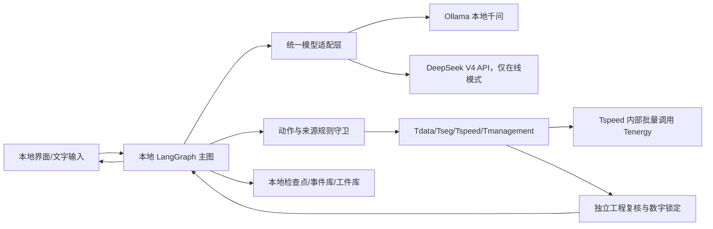

# 智行合一智能体离线构建方案

> 文档性质：论文研究系统的离线运行目标与实施指南。与[项目论文方案稿](项目论文方案稿.md)、[Agent 图结构计划](Agent图结构计划.md)及[五工具联调接口 v2](../../接口/五工具联调接口_v2.md)配套使用。本文描述待建设和待验证的能力，不把历史微调模型或当前比赛演示代码视为已通过正式规划验收。

## 1. 目标、模式与边界

离线模式在同一台研究电脑或船端计算机上运行界面、LangGraph 主图、本地大语言模型、五个数值工具、规则校验、检查点、事件记录和结果工件。任务执行期间不依赖外部模型 API 或互联网。在线模式调用 **DeepSeek V4 API**，离线模式调用本地部署的微调千问；两种模式采用相同的任务结构、模型动作协议、工具契约、工程复核和答复证据要求，差异只在模型提供者与可用数据源。模式在任务创建时确定，随任务版本记录，恢复时不得无记录地切换。在线 API 的实际服务地址、请求 `model` 标识和响应模型标识需在真实试通后记录；仓库 `.env.example` 中的 `deepseek-v4-pro` 只是当前配置示例，不能替代连通性证据。

模型模式建议定义为 `cloud`、`local` 和 `disabled`。`cloud` 指定 DeepSeek V4 API；`local` 采用严格离线策略：本地推理服务不可用时返回模型服务故障或进入明确的确定性降级流程，绝不自动把船员输入、工具结果或任务历史发送给 DeepSeek API。`disabled` 是不调用语言模型的受限演示／故障降级状态，不冒充完整智能体。是否支持船员主动切换模式，应在没有活跃规划运行时通过新任务或显式修订完成。

首版离线研究场景以文字输入、本地事实配置、历史回放和具名软件仿真为基础。实船状态读取在传感器协议、字段语义和时钟同步确认后接入；离线语音识别单独建设。只有计算设备在本地运行 Ollama，并不等于全系统已可断网运行：外部资源、云端语音、远程数据库和实时数据接口仍须逐项排查。

## 2. 本地模型现状与采用条件

仓库的 [`models/qwen2.5-7b-lora-evidence`](../../../models/qwen2.5-7b-lora-evidence/README.md) 保存了 Qwen2.5-7B-Instruct 的 LoRA 适配器、配置和训练记录，不包含完整基座。训练设备另有合并量化后的 `ship-qwen-q4.gguf`；本机 Ollama 中的 `ship-qwen:latest` 已能实际生成文本并发出原生工具请求。2026-10-15 小样本试测发现：缺数据时模型会编造位置、SOC 和航程；得到具名测试工具结果后虽能引用两组 SOC，也会添加无来源的航线和安全判断；固定 schema 输出仍会出现日期语义错误。因此当前模型只能作为**离线实验模型**，不据此宣布正式规划准入。

历史训练文档的示例把 `Action`、`Observation` 和最终方案写在同一条模型输出中，旧 ReAct 运行代码也专门截断模型生成的 `Observation`。这提示训练目标可能混淆了“模型请求工具”和“工具实际返回”；但原始 `train.json`、`val.json` 尚未完成逐条审计，不能仅凭示例断言所有训练样本都有同一问题。旧模型以三工具和固定航线为中心，也不覆盖研究系统的五工具与双电池任务。验证损失不能代替工具调用与事实忠实度测试。量化对表现的贡献须通过同题对照确认，不预设为主因。

实验接入与正式准入分开：可先用现有 GGUF 建设本地调用链，同时以规则阻断无来源工程结论；只有在冻结测试集上通过任务解析、工具调用、数字依据和端到端复核后，才能将该模型或后续重训模型作为正式离线模型。

## 3. 系统结构与模型适配

模型适配层对主图提供统一的结构化解析、决策动作、正式答复和故障结果；具体云端或本地传输封装在各自适配器中。现有 `core/llm_layer.py` 只提供 HTTPS 文本补全并要求 API key，无法靠修改 `.env` 地址完成 Ollama 接入。实施时增加独立的本地适配器，通过受限的本机地址调用 Ollama，检查模型是否存在、响应是否完整、工具请求是否为实际 API 返回的结构，记录模型标识、工件校验值、调用耗时和错误分类。统一接口中保留原始模型响应的受控引用，但面向用户只显示可公开内容。

本地模型首选 Ollama 原生 `/api/chat` 的工具请求和 `format` 结构化输出；采用兼容接口时也必须核对当前版本的工具调用语义。一次模型回合只接受主图当前允许的工程动作。模型普通文本中写出的 `Action:` 或 `Observation:` 既不是工具调用，也不是数据源；运行时只执行经过 schema、前置依赖、任务版本和预算校验的动作。实际工具返回以工具消息和结果工件引用交给模型；模型不得自己续写工具观察值。Ollama 官方的[工具调用](https://docs.ollama.com/capabilities/tool-calling)和[结构化输出](https://docs.ollama.com/capabilities/structured-outputs)文档提供接口依据，具体请求字段以本项目锁定的 Ollama 版本实测冻结。

## 4. 数据输入与一次任务的离线流程

1. **获取输入与快照。**保存船员原话、时间、模式及任务标识。本地适配器读取船载状态或研究情景快照，逐字段标出单位、来源、时间戳、质量和有效期。离线期间不可得的实时天气、水文或临时通告保持未知；过期缓存不得伪装成当前实测。必须字段缺失时追问或返回数据不足，不以模型生成值补足。
2. **语义解析。**本地模型按固定 schema 提出起终点、到达要求、载况、偏好和原文依据。程序执行地名别名核对、数字与时间归一、范围和来源检查；错别字造成多个可能地点时追问。模型的 JSON 是待核验草稿，不能凭语法正确就进入数值求解。
3. **受约束决策。**LangGraph 根据已确认请求和当前工具工件计算允许动作。模型请求 `Tdata`、`Tseg`、`Tspeed`、`Tmanagement` 或追问／试算等动作；`Tspeed` 内部批量调用 `Tenergy`。每个动作均经过规则守卫，执行后保存请求、响应、版本、耗时、失败和证据引用。无效动作被拒绝并记录，不能偷偷执行或伪造成功。
4. **数值闭环与协商。**工具沿同一计量边界、时间网格和研究情景工作。FDP 失败时只把有范围说明的诊断反馈给 Tspeed 有界重搜；预算耗尽和工具故障各有独立状态。不可行类别由工程规则与工具诊断确定，本地模型负责解释和组织已验证的调整选项；船员确认后重新计算。
5. **正式答复。**完整数值方案通过独立复核后，离线模型读取有版本的 VoyagePlan 与证据摘要，生成可查询的第一手自然语言答复。规则逐项核对航段、单位、时间、能耗、两组 SOC、约束与方案版本。模型无依据的数字、地名或安全声明使答复校验失败；可要求有界修正，再次失败则明确标识，并另行展示有来源的工具摘要，不能把摘要冒充模型原文。
6. **航中重规划。**图外本地监测器接收船载或仿真事件，按既定规则触发新版本的剩余航程规划。断网、数据过期或传感器缺失分别记录状态；旧方案可追溯，但不能在新证据下自动声明仍安全。

在线与离线运行都使用同一追加式事件规范、LangGraph 检查点和大结果工件引用。事件中记录模型提供者、模型及 GGUF 版本、模式、工具调用 ID、输入快照和答复校验结论；界面继续展示真实可折叠过程，不把模型内部逐词推理包装成审查轨迹。

## 5. 严格离线部署与资源安排

- **服务与存储：**本地启动 Ollama 和项目后端，采用本地 SQLite 检查点及本地事件／工件存储；本地界面只连接本机后端。部署启动时检查模型、工具版本、配置、数据快照和存储可写性。远端网站不能直接访问用户设备上的 `localhost`。
- **数据与网络：**严格离线模式禁用云端模型回退和外部请求；外部事实源在断网前取得且标明时间的快照可以作为历史或仿真输入，不能当作实时值。异常和缺参按统一失败语义返回。
- **前端与语音：**把外部字体、图标及部分 3D 资源改为本地静态资源。首版离线只保证文字输入；现有讯飞语音在严格离线模式禁用，离线语音识别另设任务。页面明确标出模式、模型版本和研究情景。
- **模型交付：**大型 GGUF 与代码版本分开交付；部署清单包含文件 SHA-256、Ollama 模型标识、创建配置、软件版本和兼容性记录。不得把仅有 LoRA 适配器误认为可独立推理的完整模型。
- **计算资源：**测量量化模型加载、推理、并发占用，以及 LSTM 批量预测、DE 搜索和 FDP 在同机运行时的内存／显存峰值和延迟。根据实测决定串行调度、CPU/GPU 分工、缓存和模型驻留时间，不能假定多模型可同时常驻 GPU。

## 6. 微调数据修订与模型对照

先找回并审计原始训练／验证集及构建脚本，逐条抽样检查角色划分、工具返回是否被写入 assistant 目标、无来源数字、重复模板、相邻情景泄漏和旧工具名。随后根据当前主图生成或整理多轮训练样本：船员输入 → 模型提出允许的工具动作 → 工具角色返回有来源结果 → 模型解释／下一动作或正式答复。训练时验证数据渲染和损失计算是否仅针对预定的模型输出；工具结果只作为上下文证据，不训练模型在请求工具时自行生成。具体微调格式随选定框架版本冻结。

样本覆盖正常规划、字段缺失、简称和错别字、数据过期与冲突、工具超时、预测模型域外、DE 搜索未解决、FDP 不可行、双电池不同初始状态、航中重规划及不得给出方案的情形。历史数据与软件仿真分别标注，虚构情景不能伪装为实测。按航次、航线情景和生成模板隔离训练与测试，保留从未参与调参的冻结测试集。

在相同提示、工具定义、推理预算和测试任务下，对比未微调基座、现有 LoRA/GGUF 与修订后的模型。报告动作合法率、真实工具请求率、参数正确率、日期与地名归一错误、追问与拒绝准确性、无来源工程数字、工具结果引用正确性、完整方案复核、延迟及资源成本；必要时额外比较未量化合并模型以定位量化影响。不能用训练／验证 loss 或回答文风代替规划可靠性。

## 7. 实施顺序与验收

| 阶段 | 主要交付 | 最低验收依据 |
| --- | --- | --- |
| A. 本地连通 | 模型模式配置、本地适配器、健康检查与版本记录 | 断网下可调用指定本地模型；本地故障不转云端；调用状态可查 |
| B. 受约束主图 | 结构化解析、工具请求、规则守卫、事件关联和数字锁定 | 模型自写 `Observation` 不会执行；未获工具支持的工程数字不能进入通过的答复 |
| C. 完整离线场景 | 本地界面、五工具、数据快照、检查点与工件 | 断网下完成正常、缺参、失败、人工恢复和航中仿真重规划，且可复查每次真实调用 |
| D. 模型改进与准入 | 数据审计、重训或模型替换、基座对照及冻结评测 | 满足预先商定的解析与工具调用指标；关键工程声明零无来源通过；全链工程复核通过 |

验收时断开外网并检查实际出站请求、页面资源加载、模型调用、数据库恢复和五工具运行。模拟 Ollama 未启动、模型不存在、响应超时及答复校验失败，确认系统给出明确状态而非伪造方案。研究验收分别报告“离线基础设施可运行”“模型已通过语义／工具评测”“数值链可用于正式规划”，三者不能互相代替。

## 8. 后续需冻结的具体参数

实施前需在项目负责人的统一协调下冻结：本地模型版本与交付介质、严格离线环境中可用的船载字段和事实快照、天气水文等关键输入的有效期、单机模型与数值工具的算力预算、离线语音是否列入首版、模型准入测试集和指标阈值。缺少这些信息时可开展带明确假设的研究仿真，但不扩大为实船安全结论。
