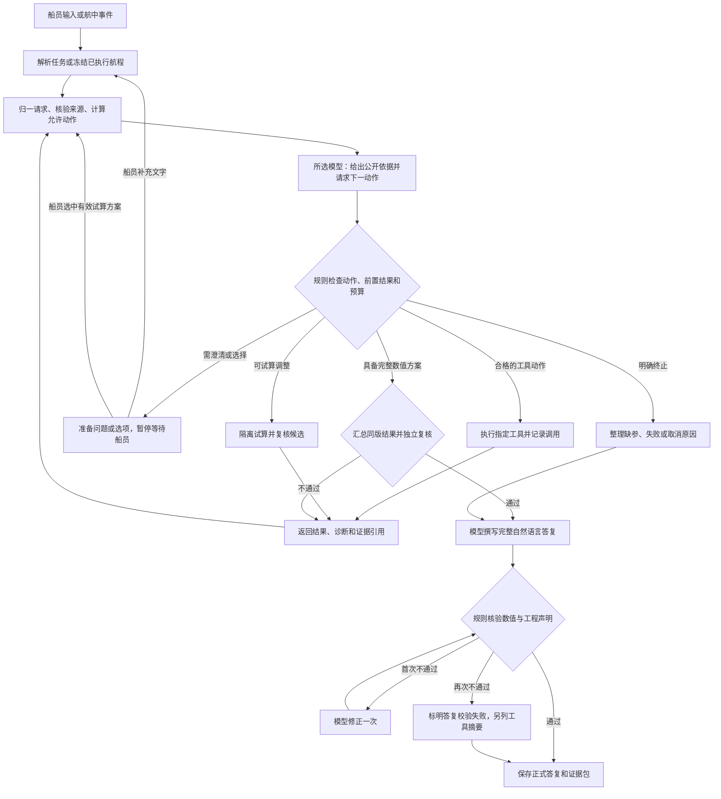

# 项目论文方案稿：基于 LangGraph 的数值可信航行智能体

> 本文描述独立设计的智能体框架及目标工作流，不等于当前演示代码的已实现能力。导师论文只用于第四节数值工具的领域方法和验证参考，不规定智能体的图结构与交互逻辑。

## 一、LangGraph 概述

LangGraph 是一个面向智能体（Agent）编排的低层框架与运行时，由 LangChain 团队开发，其设计思想来源于谷歌的 Pregel 大规模图计算模型以及 Apache Beam。它的定位是解决长时间运行、有状态、可持久化的智能体系统的编排问题，而不是提供现成的提示词或业务抽象。与常见的一次性问答型大模型应用不同，LangGraph 将智能体的执行过程建模为一张有向图，用状态、节点、边三个基本元素描述整个运行过程。

在 LangGraph 中，状态（State）是一份贯穿全程的共享数据，记录智能体在工作过程中积累的所有信息，所有节点都可以读取并更新它。节点（Node）是完成具体工作的函数，既可以是调用大模型的语义处理步骤，也可以是纯代码的确定性计算步骤。边（Edge）负责路由，决定当前节点完成后下一步前往哪个节点，既可以是固定跳转，也可以是依赖当前状态的条件分支。

LangGraph 的执行引擎采用批量同步并行模型。每一次迭代被称为一个超步，超步内部又分为规划、执行、更新三个阶段。规划阶段确定本轮要执行哪些节点，执行阶段并行运行所有被选中的节点，更新阶段把节点写出的结果合并回状态。由于一个节点存在多条出边时，所有目标节点会在同一个超步内并行执行，LangGraph 天然支持任务并行。此外，LangGraph 提供了检查点（Checkpoint）机制，能够在每个超步边界保存状态快照，从而支持对话延续、暂停恢复、时间回溯以及人机协同等能力。人机协同通过中断函数实现，它允许智能体在任意位置暂停执行、保存现场并等待人工输入后再继续。

LangGraph 对智能体编排最有价值的一点，是它允许在同一张图里混用确定性的手工代码步骤与大模型驱动的智能步骤，使开发者可以精确控制大模型在哪些环节介入、哪些环节保持可预测和可审计。

## 二、本项目的智能体核心与职责边界

本项目的智能体是“在线 DeepSeek V4 API 模型或离线本地微调千问模型、任务状态、五个数值工具、规则校验、人工选择和运行时”的整体。所选大语言模型负责理解船员语言、形成可核验的任务草稿、在关键阶段给出可公开的决策依据、请求允许的工具动作、解释试算选项并撰写正式答复。Tenergy 所用 LSTM 是推进功率预测模型，与负责交互和编排的所选大语言模型不同。五工具分别完成事实获取、航段划分、功率与能耗预测、航速优化和双电池能量管理；规则负责字段、来源、工具前置条件、工程约束和报告数值的核验；船员负责确认任务歧义及有取舍的调整方向。

### 主智能体图结构与决策权

系统采用一个主智能体决策循环，配合数值计算、协商试算和正式答复校验流程。五个工程工具是供主智能体请求的计算能力，不分别构建五个语言智能体。LangGraph 节点承载语义解析、模型决策、规则校验、工具执行、人工等待和报告生成等不同工作；固定边规定合法转移和必须完成的工程检查，模型在当前允许的动作中提出下一步请求。

这是一张受约束的模型与工具循环图：模型能根据新证据改变下一步动作，但不能跳过必要的工具及校验，也不能只因没有继续调用工具就结束任务。`Tdata → Tseg → Tspeed（内部反复调用 Tenergy）→ Tmanagement` 是形成成功方案的数值依赖；每个关键结果返回主智能体后，才由模型在允许范围内请求下一步。Tmanagement 未通过时，失败时段和功率或 SOC 限制反馈给 Tspeed 受限重搜；重搜或试算达到预算后，进入有证据的协商或失败说明。图的节点输入输出、分支和异常出口详见 [Agent图结构计划](Agent图结构计划.md)。

### 任务输入、自动取数与语义解析

正式系统首先记录船员的原始文字或语音转写、接收时间及会话标识。船员主要提供目的地、到达要求、载货任务和偏好；船上已有的位置、航速、两组电池 SOC、设备状态等应由数据适配器自动读取。航线限制、天气水文和临时通告由各自的事实配置或外部数据接口提供。每个自动读取值至少带时间戳、单位、设备或文件来源、质量标记和有效期；过期、缺失、通道含义未核实或相互冲突的数据不能伪装为当前实测。当前尚未核实的电池 capacity 字段不作为实测 SOC。研究阶段的历史回放和软件仿真通过同一输入接口提供数据，并逐字段标记为历史观测或仿真值；实船适配器待设备协议确认后接入。

解析节点采用当前模式选定的大语言模型，输出固定结构的任务草稿、每个字段的原文依据、未确定项和建议动作。模型可理解口语、简称与错别字，但地名归一必须受航线地名库约束：先匹配别名，再由模型提出候选并结合字形、拼音和航线位置核对；唯一且有充分依据的候选可归一并提示，多个候选或航线冲突时追问船员。数字、单位和相对时间由程序转换与校验；原话没有的工程数值保持未知。语义抽取之后，统一校验器检查字段类型、范围、起终点、时间关系、双电池状态和数据来源，合格后才形成正式航行请求。

追问采用“规则确定触发条件、模型组织问法”的分工。规则根据缺项、歧义、数据过期和冲突生成待澄清字段与可用候选；模型结合上下文写成船员易回答的问题。选项仅来自已核实地名或实际试算结果；没有依据的时间、电量等不能被编成选项。船员补充后只更新相关字段，保留原始表述和修订历史，再运行同一校验器。模型或语音服务不可用时，可用现有规则解析器处理明确支持的句式；其余情况返回缺参或服务失败，不能默默补值。

### 模型发起动作与工具执行

在每个关键阶段，所选模型以受约束的结构输出“面向用户的决策依据摘要＋下一步动作请求”。允许的动作包括追问、请求数据、请求分段、请求已知轨迹的能耗检查、请求航速优化、请求双电池管理、请求调整试算、展示试算选项、申请正式答复和明确结束任务。运行时依据当前状态检查动作是否合法、参数是否完整、所需的前置工具结果是否存在；不合法的请求被拒绝、记录并要求模型修正，不能直接执行。模型看到工具返回的结构化摘要后决定下一步可选动作，运行时保留对任务依赖与硬约束的最终控制。

模型动作至少包含动作类型、参数、所依据的请求修订和方案版本、证据引用及可公开的依据摘要。优先采用所选模型实际支持的工具调用和结构化输出能力；只有文本输出时须显式作为兼容模式，用 schema 校验后才能执行，不能把自由文本解析冒充原生工具调用。首版每轮只接收一个工程动作，依赖未满足或版本过期的调用返回结构化拒绝及原因；每次实际工具响应、拒绝或故障与原动作 ID 关联，再交给模型阅读。规则同时检查模型决策轮数、重复无进展动作及各类试算预算，避免图无期限循环。

DE 对大量候选航速的评价由 Tspeed 在内部批量调用 Tenergy；所选模型无需逐个决定候选速度。每次批量调用仍生成可查询的调用记录，包含候选数量、输入与输出引用、模型版本、耗时和状态。正式系统须将现有“固定候选能耗表先于 Tspeed”的演示接口升级为 Tspeed 可反复调用的 LSTM 预测接口，并将五工具结果纳入同一方案版本。

共享任务状态至少记录：原始输入与对话、结构化请求及其修订、数据快照和来源、航段、工具结果引用、当前节点与状态、失败诊断、协商选项和船员选择、已执行航程、当前方案版本、正式答复版本、数值校验结果及事件序号。工具大规模时序不直接塞入对话或检查点，由结果工件存储并以 ID 引用。LangGraph 检查点保存可暂停和恢复的任务现场；独立的追加式事件记录保存可审查的执行过程，二者不能互相替代。

状态字段在实施时按任务标识、对话、请求、数据快照、工具结果、人工待答事项、规划版本、航行执行、运行控制和答复分组建立类型定义。对话消息使用稳定消息 ID 合并；当前有效结果用引用替换，历史工件和请求修订保留。候选方案、已通过工程复核的方案和当前采用的方案分别存放；试算另有 `trial_id`，不能按工具名称覆盖多轮结果。起终点、期限、双电池状态或环境情景变化时，按依赖范围使下游结果失效，并核对请求、快照、模型与约束版本后才允许复用。

运行生命周期、工程结论和答复校验分别记状态：例如任务可处于等待船员，DE 可处于“尚未找到可行候选”，模型正文可处于“数字校验失败”。三个维度不合并为一个 `feasible` 布尔值。当前数值方案通过而模型正文不通过时，保留方案和失败正文，另提供有来源的工具摘要；工具超时不能归类为电量不足。

### 可公开的决策依据与完整调用记录

系统展示的是模型明确输出的、面向审查的决策依据摘要，以及实际发生的模型请求、规则判定、工具调用与船员操作。摘要应说明“根据哪些输入或工具结果，为什么请求这一步”，并引用已有字段；它不被标成模型内部逐词推理。不得事后为固定流程编造“模型正在思考”的动画或文案。模型原始 API 响应、经校验的动作和被拒绝的动作均保留审计记录；对外展示按角色过滤密钥及不宜公开的原始数据。

每条事件至少有 task_id、run_id、plan_version、递增序号、时间戳、执行者（模型／工具／规则／船员）、事件类型、节点、输入输出引用、状态、耗时、模型或工具版本、来源和可公开摘要。一次工具调用分别记录请求、执行与返回；失败或超时同样记录。大规模功率时序和 DE 候选保存为带哈希和版本的结果工件，界面显示摘要并支持分页查看或导出明细。用户刷新页面后应能按事件序号继续读取，不能丢失已发生的过程。

每次动作与调用使用稳定的 action_id、call_id 和父调用 ID；Tspeed 内部每批 Tenergy 预测须有子调用记录，批内候选保留可分页的输入输出索引。重试记录 attempt ID，缓存复用明确记为命中缓存，不能伪装成一次新推理。持久化层分为 LangGraph 检查点、追加式事件库和大结果工件库：检查点负责恢复，事件库负责时序审查，工件库保存轨迹、候选和原始模型答复。事件先落库再推送，恢复时以稳定调用 ID 对账，避免中断节点重放或请求重试造成重复方案。

### 正式答复、证据包与数字校验

五工具结果由智能体运行层关联为一份结构化 VoyagePlan：航段来自 Tseg，候选功率与能耗来自 Tenergy，选定航速与时间来自 Tspeed，两组电池轨迹来自 Tmanagement；Tdata 提供本次采用的事实与来源。汇总步骤只建立关联、统一版本并检查单位、时间、能量及约束一致性，不创造新的工程结论。全部通过后，所选模型读取经过复核的方案和来源，生成完整自然语言答复，包括任务理解、推荐方案、理由、取舍、风险与假设。正式答复是用户首先看到、可保存并重新打开的主要产物，不由前端固定模板拼写。

答复中的关键数值声明需关联方案字段、单位和方案版本。确定性数值锁定组件核对引用、数值、单位、汇总关系和可行性表述；模型不能给自己的数字结论盖章。保留模型原始答复草稿、校验记录及通过校验的正式版本。校验失败可要求模型修正一次；仍不通过时明确显示“模型答复校验失败”，并另提供有来源标识的工具结果摘要，不能将摘要冒充模型原话。任务缺参、工具失败或方案不可行时，模型应生成对应的说明与可用下一步，而非成功航行方案。

首版答复协议由模型正文和工程声明引用组成：每条关键声明记录正文位置、方案字段、数值、单位、来源与版本，支持点击正文跳到工具输出和原始依据。校验器除检查模型列出的引用，还要检查正文中是否遗漏了需要核验的工程数字与结论；无法可靠映射的关键声明不能直接放行。对日期、中文数量、区间、单位换算和派生值制定确定性规则；首版明确支持的声明类型，不声称自动理解所有自由文本。生成中的流式正文只显示为未核验草稿，通过后才发布正式版本。

## 三、工作流、异常处理与可观察交互

### 航前规划主流程

主流程为：船员输入及自动状态读取 → 所选模型生成任务草稿与动作 → 规则归一、来源检查和追问路由 → Tdata → Tseg → Tspeed 在 DE 搜索中批量调用 Tenergy → 对入选方案运行 Tmanagement → 独立约束复核 → 所选模型生成正式答复 → 数值锁定 → 保存答复及证据包。每个关键工具结果返回后，模型可生成可公开的状态理解与下一动作；图规则检查前置条件和终止状态。工具调用、模型决策和规则判定均写入事件记录。最终可行性必须同时经过航速和双电池检查；FDP 失败时将具体功率或 SOC 约束回传给 Tspeed 限定重搜，达到配置上限仍失败才进入协商。

数值流程中，DE 自行生成、筛选和演化候选航速，以同版环境情景反复调用 LSTM 的批量接口；模型只请求启动优化、阅读结果及决定允许的后续动作。最终候选须重新计算并检查限速、加减速、时间、功率和能量约束，然后把逐时需求交给 FDP。FDP 对两组电池的功率、SOC 和模式检查失败时，返回触发时段、限制及模型适用范围；经主图动作检查后进入受限重搜。没有找到可行候选仅表示当前搜索未解决，不直接证明所有方案均不可行。工具返回的“可行”仍须通过独立的时间、距离、能量守恒、计量边界、来源和版本复核，才能进入成功答复。

### 状态分类和不可行协商

系统至少区分：需要追问（输入缺失、歧义、冲突或自动数据过期）、数据或模型不适用、求解未找到可行解、经过诊断的方案不可行、工具执行失败、等待船员选择、方案成功。DE 没有找到可行个体不能单独证明数学上无解；需要记录多次搜索、可解析边界或独立约束诊断。“模型不适用”也不能冒充电量不足。具体状态枚举和接口在下一轮状态与接口设计中冻结。

失败分类按发生环节细化：解析与 Tdata 的缺参、冲突和过期数据进入追问；Tseg 的航线、限速和通航条件冲突进入航段诊断；Tenergy 的必要特征缺失或超出适用范围进入模型适用性诊断；Tspeed 的时间、电量、功率或组合约束进入优化诊断；Tmanagement 的单组功率、双组总功率、SOC 或模式约束进入双电池诊断；最终校验不通过进入答复修正或失败处理。每类至少返回触发字段、实测或预测值、限值、单位、数据来源及可否试算调整。

不可行类别及允许调整动作由版本化规则表预先定义，具体失败证据由工具和独立检查器提供。模型可结合船员偏好建议优先试算的方向，并解释取舍，但不能自创工程上未经支持的动作。意图翻译器把允许的方向转成输入修改，调用真实工具完整试算；只展示经过试算且状态明确的选项。船员通过中断节点选择，服务端按保存的 option_id 应用修改并重新校验。可商议的到达时间、出发安排和有来源的补能条件与不可擅自修改的限速、设备功率和双电池安全下限分开管理。旧反思稿中的“直接降低 SOC 下限”与当前工具任务书冲突；须先区分任务期望余量与硬性规划下限，在界限冻结之前不作为正式协商动作。

协商试算使用独立的输入副本和试算 ID，不能覆盖当前已确认任务或正在采用的方案。若考虑补能，须先确认设施位置、可用性、充电功率与效率、停靠时长、通航窗口以及两组 SOC 更新，再让 Tseg 对该候选停靠任务产生断点并重算下游工具。补能条件不足时该调整方向不可用，不在 Tseg 内按“最近补能点”自动插入，也不以统一 25% SOC 阈值直接宣告不可行。展示给船员的可执行选项必须完成双电池和独立约束检查，失败试算只供查证。

### 人工暂停与任务恢复

关键字段需澄清或船员需在试算选项中取舍时，先保存问题、选项、来源和待答事项 ID，再在 LangGraph 等待节点调用 `interrupt`。同一 `thread_id` 的恢复请求携带待答 ID、请求修订、方案版本和幂等响应 ID；服务端检查提交者权限、选项有效性及数据时效，合格后用 `Command(resume=...)` 恢复。自由文字重新解析，不能直接当作数值补丁；过期选项重新试算。中断节点在恢复时可能从头执行，因此模型提问、选项试算和不可去重的写入放在等待节点之前的独立节点，重复提交不得生效两次。等待人工属于运行中的暂停状态，不等于任务结束。

### 航中重规划与仿真数据源

研究阶段采用统一的航中状态输入接口，分别承接按连续时间顺序回放的历史有效字段与软件仿真器产生的位置、两组 SOC、环境变化和临时通航事件；每项标明来源、时间和质量。仿真器只提供动态状态与事件，不替代 Tenergy、Tspeed 或 Tmanagement 计算。仿真器的状态推进、扰动生成、参数标定及验证需另成详细构建方案，不能将当前配置视为已实现的仿真器。未来实船接入时以船载数据适配器替换输入提供者，先核对传感器协议、同步和字段语义。

规则先检查输入有效性。临时限速、航段不可通行等硬事件立即触发重规划；软偏差依据更新状态下的预测到港时间、剩余能量余量与原方案的差值，采用有来源的阈值、连续样本确认和最小重规划间隔避免抖动。导师论文的 1800 秒周期只作周期重算实验起点，最终周期与阈值通过仿真场景验证确定。触发时锁定已完成航段、实际已消耗电量和上一方案版本，以当前位置和最新可信状态重算剩余航程；新旧方案差异与触发原因写入事件记录。数据无效时显示状态异常并暂停重算；重算失败时不得把失效的原计划标为安全的新计划。

航中监测作为图外事件入口运行，每次触发提交一次有版本的剩余航程规划，不在主图中无限轮询。已走航段及当前段已执行部分不再优化；同一任务只允许一个活跃写入运行，利用版本检查或数据库租约阻止过期求解覆盖新方案。软事件可按最新可信快照合并，硬事件保留优先处理。航中重算失败时保留旧方案供追溯，但重新判断其当前有效性；改变任务期限或停靠等取舍仍交船员确认。

### 界面、查询接口与持久化

界面上方展示服务端保存的大模型正式答复；运行期间显示真实阶段进度和模型已生成的可公开说明。其下设置可折叠的过程时间线，按任务理解、取数、分段、航速与能耗、双电池、校验、答复等阶段分组。每项标出执行者、时间、状态和摘要；展开可查看模型动作、工具输入输出、约束结果、人工选择以及关联来源。点击正式答复中的数字或重要结论，应跳转到对应方案字段、工具调用和数据来源。另提供当前节点、等待事项、方案版本、失败原因及可恢复状态的任务状态面板。

后端创建任务后立即返回 task_id、thread_id 和 run_id，后台执行并在事件落库后推送进度；提供任务状态查询、按序号分页读取事件、单项工具结果明细、答复版本和事件流接口。事件流可用 SSE 实现，断线后按最后序号补读；浏览器断线不取消后台任务，任务恢复仍由 LangGraph 检查点支撑。调用与事件使用稳定 ID，重复恢复不能生成两次互相矛盾的正式方案。前端按任务理解、取数、分段、航速与能耗、双电池、协商、检查和答复展开实际过程，展示当前节点、等待事项及新旧方案差异。现有同步等待最终结果的接口和只列节点状态的前端需升级，前端不能再自行用固定程序生成“模型最终答复”。

### 在线与离线模型运行模式

研究系统在统一的 LangGraph 图、工具接口和工程校验之上设置两种模型运行模式：在线模式调用 **DeepSeek V4 API**，离线模式调用本地部署的微调千问。在线请求的服务地址、实际 `model` 标识和响应模型标识须在接入时真实试通并记录，不能仅凭模型名称推断接口可用。离线模式由任务创建时明确选择，在本机运行界面、主图、千问模型、五工具及检查点和事件工件存储；它只读取有来源的船载状态、本地事实快照、历史回放或具名仿真数据。离线期间取不到或已过期的关键事实保持未知，不以模型生成值替代。严格离线任务中的模型故障不能自动回退到 DeepSeek API；外部字体、图标、部分三维资源和云端语音也必须本地化或关闭，方能称为断网可用。

现有微调千问模型已可在本机推理并提出原生工具请求，但抽样实测出现虚构船舶状态、航线和安全结论，暂列离线实验模型。正式离线接入需建设独立 Ollama 适配器，统一模型动作与答复协议；运行时只执行经过规则校验的真实工具请求，拒绝模型自行生成的 `Observation`。正式答复继续由所选模型撰写，数值和工程声明由规则按同版工件核对。原始训练数据的角色划分、工具返回与验证集还需审计；模型正式准入须经过冻结任务集的调用、缺参、事实忠实度和端到端工程测试。详细构建、数据修订、部署与验收方案见[离线构建方案](离线构建方案.md)。

### 实施顺序与系统验收

先冻结共享状态、模型动作、诊断、事件与五工具接口，尤其统一时序网格、功率计量边界和双电池参数；再完成模型结构化解析、主决策循环及动作检查。接着接入 LSTM—DE—FDP 的数值闭环、失败反馈和隔离试算，实现服务端完整答复、字段级数字锁定、人工中断恢复及事件工件存储；最后接入可折叠界面与航中仿真重规划。各类循环分别配置决策步数、无效动作、工具重试、速度与双电池重搜、协商试算、人工轮次和答复修正预算，具体阈值以实验冻结。工具算法的单项验证沿用各任务书，智能体另做端到端验收。

离线分支按本地模型连通、受约束主图、全系统断网运行和模型准入四步推进；将“本地服务可调用”“模型输出可靠”“五工具方案通过工程复核”分别验收。模型基座、现有微调版与改进版在相同任务上对照，并记录无来源数字、无效工具动作、资源占用和故障恢复。具体检查项见[离线构建方案](离线构建方案.md)。

验收场景至少覆盖：地名简称或错别字、关键字段缺失、船载数据过期、Tenergy 模型不适用、Tspeed 与 Tmanagement 各自不可行、船员选项确认、模型越权工具请求、工具超时、报告数字不一致、航中硬事件和软偏差触发、页面刷新及服务重启恢复。每次运行都应能按顺序查看真实模型动作和全部工具调用；正式答复有版本、模型标识和字段级依据；失败状态不伪装为成功；软件仿真结果始终带清晰的研究情景标记。

## 四、工具系统设计

本项目的计算层由五个结构化工具组成，它们全部以结构化数据为输入输出，杜绝自由文本传值。工具的领域方法参考刘汉有《内河船舶航速与能量管理协同优化方法与试验研究》中针对“豫交投001”的航行工况、航速优化和双电池能量管理研究；本节提及的论文页码为该PDF的阅读器页码。导师论文为工具建模提供方法依据，不决定上文的智能体编排设计。

五工具采用同一版研究系统接口：任务修订、数据快照、研究情景、工具调用和模型/算法版本贯穿 Tdata、Tseg、Tenergy、Tspeed、Tmanagement。Tdata 提供两组独立电池参数与逐字段来源，Tseg 提供有稳定 ID 的航段及约束；Tspeed 在 DE 搜索中批量调用 Tenergy 取得逐时电机侧功率，并通过唯一的需求构建适配器换算为母线需求，再把选定轨迹和同一需求工件交给 Tmanagement。FDP 的失败诊断只能在注明适用范围后反馈给 Tspeed 有界重搜。主图关联五工具结果形成方案，独立检查时间、距离、功率边界、能量积分和两组 SOC；工具单步成功或模型答复均不能替代完整方案的工程核验。

接口统一规定单位、时序区间、来源与假设、结果工件引用和可追踪调用记录；分别表达缺参、模型域外、搜索预算内未解决、已记录假设下不可行及运行故障，不把有限搜索失败称为数学无解。未经验证的转换参数或充电状态转移不能用于实船安全结论；补能试算须在设施与充电模型具备来源后扩展。详细字段、失败语义、联调验收及迁移要求见[五工具联调接口 v2](../../接口/五工具联调接口_v2.md)。该文档当前为 `research-tools/2.0-draft` 目标契约，现有 `schemas` 和演示代码仍为 v1，需按冻结后的 v2 接口显式迁移。

数据获取工具负责补全船舶、电池与环境状态，优先采用经过质量核验的船载状态与有来源的任务输入，其次采用已核实的事实配置；研究仿真可显式使用具名假设，关键参数无依据时返回缺参，并为每一项数据标注来源，同时对异常值做检测，当用户输入与事实表冲突时返回冲突提示而非静默修正。导师论文使用豫交投001的航速、推进功率、水流、水深和风等航行数据建立工况与模型（PDF第50–55页）。本项目对已有两份CSV和独立Excel分别清洗与记录来源；同时间戳多行、缺失值及异常值不直接当作独立有效样本。用户已确认CSV对地航速单位为节、`motor_power`单位为千瓦，但电机功率不能未经计量边界核对便当作电池侧总能耗。

航段划分工具负责把航程切分为约束同质的子航段。导师论文以港口和船闸等固定节点，将周口至平顶山航线划分为17个典型航段，并分别处理进出港、过闸和巡航区间（PDF第52–53页）；这为本项目的基础航段、节点顺序与限速类型提供参照。本项目采用候选断点加激活条件的设计，断点分为八类：船闸为硬断点必切，港口码头在有停靠任务时切，补能点在有经确认的补能停靠任务及设施条件时切，限速区、桥区和管制区必切，水深受限区在水深逼近吃水时切，气象和水文突变点按阈值触发，时间锚点按任务要求切分。工具支持任意有效起点、返程及剩余航程；论文中的航段限速是研究场景参数，实际航道约束仍须核对来源。

能耗预测工具 Tenergy 以长短期记忆网络（LSTM）作为正式研究模型，预测对象先明确为主推进电机功率（kW），再按预测时序积分得到推进电机侧电耗（kWh）。导师论文针对豫交投001采用对地航速、加速度、水流速度、水深、风速和风向预测推进功率（PDF第73–75页），本项目复用“时序功率预测—能量积分”的方法，但模型须用本项目数据重新训练和评价，不能借用论文中的预测精度。输入包含已观测的历史状态、拟执行的未来航速轨迹和可获得的未来环境情景；历史功率只能作为预测时刻以前的状态输入，不能使用未来真实功率。对每个候选航速方案，工具在固定时间步长上生成预测功率序列，计算航行及等待耗时、峰值功率、推进电耗、模型适用范围和异常标记，为 Tspeed 提供可重复调用的批量评估接口。电机侧与电池侧、推进与辅助负载分别记账；未经标定的效率和辅助负载不得默认为零，到达 SOC 由双电池模型计算。

现有数据允许开始构建 LSTM，但验证强度须分层表述。独立 Excel 有 12,257 个连续 5 秒时间点，航速、水流速度、水深、风速、风向五项原始输入及电机功率均有数值，加速度可由相邻航速计算；其中航速和正电机功率同时成立的时间点为 7,037 个，可形成 6,635 个连续 17 点窗口。这些重叠窗口仍来自同一份航行记录，不能算作 6,635 次独立验证。两份 CSV 按时间戳合并后分别有 6,324 和 11,340 个速度—功率配对时间点，但缺水流速度列，且风速单位码未解释。因此先训练跨三份来源共用字段的 LSTM 主模型，以航速、由航速差分得到的加速度及有效水深等可核对变量为起点；导师六输入版本可在 Excel 上作为扩展实验，不能据此声称跨航次泛化。数据预处理需要按时间戳去重、保留缺失与冲突标记、区分停泊和航行工况、按独立来源或连续时间块划分训练与验证，不随机拆分相邻窗口。另保留简单功率基线用于检验 LSTM 是否真正带来收益；对样本覆盖外的候选航速须拒绝、限域或标记为外推，不能用模型输出冒充可靠实测。

航速优化工具 Tspeed 以差分进化（DE）作为正式求解算法，决策向量为各航段目标航速或航段内允许调整的航速参数；每个候选方案调用 Tenergy 的 LSTM 批量预测接口取得功率与电耗，目标是在满足到达时间、分段限速、加减速、航行距离、功率、电池预算和通航管制约束下最小化预测总能耗。导师论文对豫交投001使用 DE，并设定 1800 秒滚动优化周期（PDF第70–78页）；种群规模、迭代次数、变异与交叉参数先按论文作为可复现实验起点，再根据本项目计算成本和结果稳定性调参，滚动周期由场景试验确定。求解过程记录随机种子、模型版本、约束配置、迭代轨迹和耗时；最终候选重新调用 Tenergy 与约束检查器核验，返回可行性及结构化失败原因。DE 是启发式算法，不宣称全局最优；有限候选或规则航速保留为实验对照。规划 SOC 下限等安全边界不得由语言模型放宽，可商议的时间、出发或补能选项须经工具重算和船员确认。

能量管理工具 Tmanagement 直接采用导师论文的前向动态规划（FDP）方法作为正式研究算法：将 Tspeed 选定方案的预测功率时序与辅助负载换算为双电池待供功率，在“1 号电池单独输出、2 号电池单独输出、两组共同输出”三种模式及各模式允许的功率分配中搜索。状态为两组电池各自的 SOC 和上一时步模式，逐步更新两组的能量；代价函数纳入功率损耗或使用成本、模式切换、SOC 差和低负荷双组运行惩罚，同时硬性检查单组功率、SOC 下限与转换效率。时间步长和 SOC 离散粒度须在计算量与误差之间实验确定。输出每个时步的两组电池功率、SOC、模式、费用分项和约束检查，并汇总至航段；状态机策略作为对照。导师论文给出上述三模式和代价项（PDF第101–103页），本项目复现方法并重建参数与程序，不直接移植论文的实验结果。两组电池是可调度的研究模型，不预设实船固定分工；容量、初始 SOC、功率上限、效率和权重须来自核实资料或明确标注的仿真假设，Excel 中未确认含义的 `capacity` 字段不能直接充当 SOC。当前公共接口只有合并电池的容量与 SOC，实施 FDP 前须升级为两组独立状态并让 Tspeed、Tenergy、Tmanagement 共用同一功率和能量口径；FDP 判为不可行的航速方案返回 Tspeed 重算。

工具验证采用相同航程、环境、初始 SOC 和约束条件，对照规则航速与 DE 航速、状态机与 FDP 的四种组合。LSTM 单独报告跨来源或连续留出区间上的 MAE、RMSE、能量积分误差及不同航速区间误差；DE 报告预测能耗、准时性、约束违例和计算耗时；FDP 报告两组 SOC 差、功率波动、模式切换次数、损耗与约束违例。组合实验同时记录速度优化与电池均衡之间的取舍。导师论文指出，纯电船的主要节能空间由航速决定，电池策略着重维持 SOC 均衡和动力系统稳定；其仿真与缩比试验结果只作为文献参照，不预填为本项目的实测效果（PDF第119–121、163–164、171–177页）。当前演示代码仍为三次方合成能耗、有限候选网格求解和合并 SOC 预算，尚未实现上述 LSTM、DE 与双电池 FDP；上述内容为正式研究系统的构建目标。

三项工具的组员实施与验收细则分别见 [Tenergy任务书](工具任务书/Tenergy_LSTM能耗预测工具_任务书.md)、[Tspeed任务书](工具任务书/Tspeed_DE航速优化工具_任务书.md)、[Tmanagement任务书](工具任务书/Tmanagement_FDP双电池能量管理工具_任务书.md)。三人先冻结同一版时序、功率计量边界和双电池参数接口，再分别实施与联调。

在五个工具之外，系统设置意图翻译器与数值锁定组件。意图翻译器以版本化映射表限定不可行类型、允许的调整方向和输入修改；所选模型可根据船员偏好建议优先试算的方向，最终选项必须经规则筛选与工具复核。数值锁定组件核对正式答复中引用的方案字段、单位、版本和可行性表述，偏离时保存校验记录并要求模型修正一次；再次失败则明确标示模型答复未通过，并另行展示工具结果摘要，不把摘要伪装成模型答复。

## 五、总结

本项目以 LangGraph 为有状态运行底座，让所选大语言模型在规则限定的动作空间中理解任务、请求工具、解释结果并撰写正式答复；五工具承担工程计算，规则与船员分别处理客观边界和实际取舍。正式答复与方案证据包共同保存，模型决策摘要、每次工具调用、状态变化和数值引用均可查询。研究系统通过单工具实验、组合优化实验及端到端智能体验证，检验方案的有效性、可追溯性和动态重规划能力。
