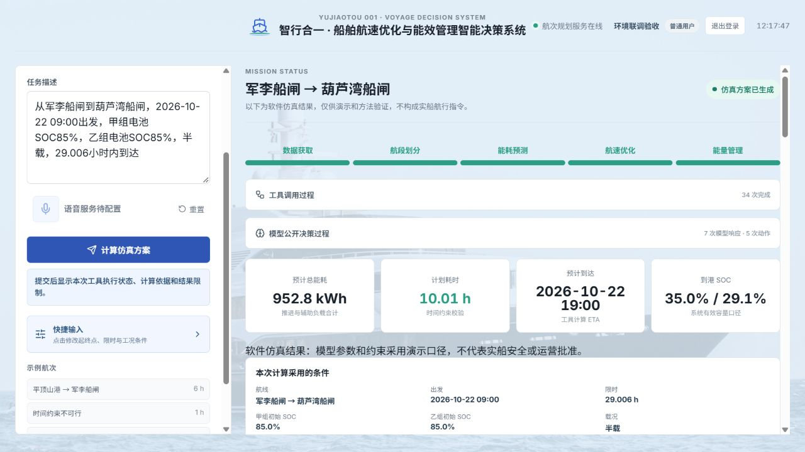
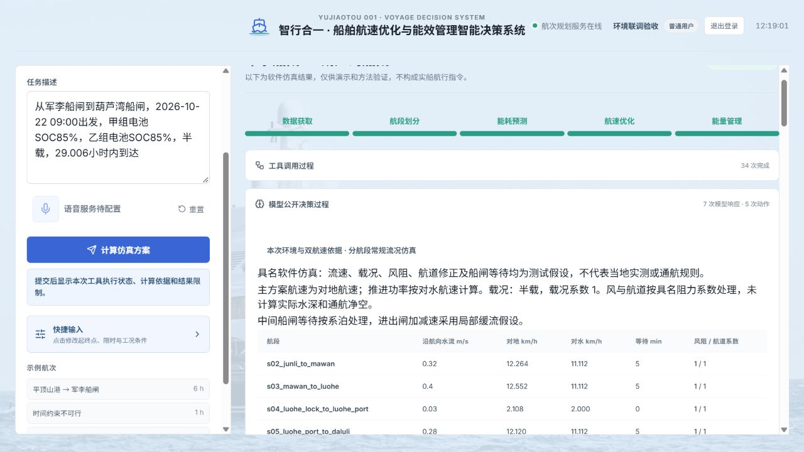

# 分航段环境仿真升级与十次网页验收报告

日期：2026-10-21。开发分支：`codex/environment-simulation-20261020`；基线：`5da2bc6`。

## 1. 结论与范围

通过真实浏览器在本机网站 `http://127.0.0.1:8767/` 提交十种航次任务；页面表单、模型解析、LangGraph 工具动作、实际 DE/FDP、独立复核和结果渲染均参与。全部调用实际 API 模型 `deepseek-v4-pro`。

修复后十项检查通过：8 项生成通过独立复核的仿真方案，2 项分别因电量与时限约束正确拒绝。不是把十项都强制变成可行。初轮发现的 2 处输入识别错误及重测记录见下文。

这是本机待发布版本的验收，未修改 Render 的账号、环境变量或线上部署，也未将本分支并入 main。十项不构成所有输入、并发负载或实船适用性的证明。

## 2. 十项结果

除表中说明，均为半载；出发时刻统一为 2026-10-22 09:00（Asia/Shanghai）。能耗列为母线侧推进和辅助负载合计，SOC 分别为甲/乙组。运行秒数来自后端实际开始和完成时间，含模型及求解耗时，不含人工查看等待。09 与 06 有并发重叠，因此不是性能基准。

| 序号 | 航次／条件 | 时限 h | 实际运行 s | 航时 h | 母线能耗 kWh | 到港 SOC | 结果 |
|---|---|---:|---:|---:|---:|---|---|
| 01 | 漯河船闸→漯河港；85%/85% | 2 | 19.4 | 0.196 | 1.582 | 85.0%/84.8% | 可行，复核通过 |
| 02 | 漯河港→漯河船闸；80%/65% | 2 | 19.6 | 0.207 | 1.688 | 79.8%/65.0% | 可行，复核通过 |
| 03 | 平顶山港→军李船闸；85%/85% | 6 | 33.8 | 2.155 | 217.120 | 72.9%/72.9% | 可行，复核通过 |
| 04 | 军李船闸→平顶山港；85%/85% | 6 | 35.9 | 2.454 | 247.210 | 71.3%/71.3% | 可行，复核通过 |
| 05 | 马湾船闸→漯河港；85%/85% | 8 | 57.8 | 3.927 | 356.152 | 65.1%/65.3% | 可行，复核通过 |
| 06 | 漯河港→马湾船闸；95%/90%；空载 | 8 | 101.4 | 4.774 | 417.985 | 71.0%/67.5% | 可行，复核通过 |
| 07 | 漯河船闸→漯河港；25%/25% | 2 | 14.9 | — | — | — | 正确拒绝：两组电量均在规划下限 |
| 08 | 平顶山港→军李船闸；85%/85% | 1 | 18.8 | — | — | — | 正确拒绝：1 h 低于至少约 1.77 h 的航时下界 |
| 09 | 军李船闸→葫芦湾船闸；85%/85% | 29.006 | 151.0 | 10.010 | 952.751 | 35.0%/29.1% | 可行，复核通过 |
| 10 | 大路李船闸→葫芦湾船闸；80%/90%；满载；优先最短航时 | 6 | 46.1 | 1.724 | 311.852 | 63.7%/71.7% | 可行，复核通过 |

### 关键核对

- 01/02：短子航段正反向、两组不同 SOC 均被保留；02 不再只返回独立预测。
- 03/04：同一 25.5 km 物理段，顺流对地 11.832 km/h、逆流 10.392 km/h，对水均为 11.112 km/h；逆流航时和能耗增加。
- 05/06：各有一次 300 s 中间船闸等待。等待时推进为零、辅助负载继续；等待只计一次，进出闸速度连续。
- 07：25%/25% 已处于规划下限，未发布可行结果；建议先补电并录入新 SOC，明确仅放宽到达时间不能解决无可用电量。
- 08：保留用户 1 h，返回至少约 1.77 h 的乐观航时下界；建议延长期限或改选更短航段。下界未计完所有加减速，不能作为保证可达的新期限。
- 09：保留 29.006 h，117.289 km、三次等待共 900 s；总航时 10.010 h，母线能耗 952.751 kWh。按放电效率 0.9，两组 SOC 合计消耗约 1058.613 kWh，与末端 35.0%/29.1% 闭合；途中没有充电。
- 10：保留满载、80%/90% 和 min_time；对地航速 14.4456 km/h，对水 13.1856 km/h。确实切换了最短航时目标。
- 8 个成功任务均执行 Tdata→Tseg→Tspeed（内部 Tenergy）→Tmanagement→独立复核；真实模型响应为每项 7–8 次。失败任务保留诊断，无成功工件。
- 工件读取检查 SHA256 与任务归属；界面能耗、时长及双电池 SOC 与后端数值在显示舍入容差内一致。所有任务无未处理工具异常或 worker 异常。

## 3. 网页测试发现并修复的问题

### 3.1 航次被误识别为独立预测

02 初轮是明确的返程航次和 2 h 期限，模型仍将 task_type 判为 prediction，仅显示预测能耗，没有 ETA、双电池分配和完整方案。已在 `research/agent/runtime.py` 增加规则核对：明确起终点和到达期限时执行 planning；用户明确说“只预测／不做优化”仍保留预测入口。规则修正会记录 input_normalized 事件，模型继续真实请求每个工具动作。

初轮记录见 `任务分类修复前网页证据.json`；02 重测走完完整工具链并通过复核。增加故意让测试模型误判任务类型的回归，覆盖规划及明确只预测两种意图。

### 3.2 登记的港口／船闸被模型改写或遗漏

06 初轮已写出“漯河港→马湾船闸”，模型却提交漯河船闸且遗漏终点，触发了多余追问。初轮任务 ID 为 `7695d2d0-c7a5-4be7-b125-426790cd7b6f`，后续被用于测试澄清恢复，不计入最终十项。

增加已登记地名的原文核对：完整路线按登记表保留，港口与同名船闸不混用；未登记地点保留澄清，不用已知地点替换。澄清恢复时只核对最新用户消息，防止旧航线覆盖新修改。06 重测保留起终点、空载和两组独立 SOC，完成分配及独立复核。

### 3.3 本次环境实施时修复的相关边界

- 取消给航速结果添加随机扰动的旧逻辑，环境修正在预测、搜索、需求导出、FDP 和独立重放中统一生效。
- 加入对地／对水航速区别与正返程水流方向；缓存包含环境、分段和阶段信息。
- 等待前减速至零、等待后重新起航；巡航下限允许加减速阶段低于该值，仍核对功率与速度连续性。
- 初速高于局部速度上限时修正航时下界，避免仅用距离/局部上限误报物理不可行。
- 恢复 LSTM 路径所需 hashlib 导入；前端百分比按比例单位显示，不直接把 0.85 当 0.85%。

## 4. 环境模型当前实现

集中配置在 `configs/environment_scenarios.json`，版本 `2026-10-20.1`。五类具名情景：静水、分段常规流况、强逆流、船闸延误、风与航道修正。每次 Tdata 保存参数及内容哈希，Tseg 按物理段和方向投影，后续工具绑定同一快照。网页十项使用默认分段常规流况；风/航道和强流另有真实 API 与自动化用例。

基本关系：`对水航速 = 对地航速 - 3.6 × 沿航向流速(m/s)`；`推进功率 = c × 对水航速³ × 载况系数 × 风阻系数 × 航道系数`；`母线功率 = 推进功率 / 0.94 + 5 kW`。距离仍由对地航速积分。两组电池各 1000 kWh，放电效率 0.9，规划 SOC 下限 25%。

空载/半载/满载系数为 0.9/1/1.1；常规流速、200 kW 电机边界、风阻与航道系数均为具名假设。系泊等待仅计辅助功耗，进出闸加减速采用局部缓流假设。未计算真实水深、流场、闸门调度或气象预报。

主表显示对地航速；原有“模型公开决策过程”中可展开环境、对水航速、等待、版本及哈希。保持原版前端布局。

多个航段仍可能得到相同对水经济巡航速度：目前低功率与宽松期限下，最小能耗解常取巡航下界；分段水流使对地速度不同。没有人为随机改写结果，也不把 DE 少量迭代称为全局最优。

真实 LSTM 继续使用已有短时历史与权重，未把上述解析环境修正叠加到 LSTM，也没有宣称 LSTM 支持全航程。

## 5. 自动化与复现

- 最终完整 Python 回归：**595 passed，247.40 s**，原始输出见 `pytest-final.txt`。
- 前端 Node 回归：7/7 passed。
- 真实 API 独立环境验收：5/5 passed，涵盖正返程、风/航道、紧时限、最低 SOC，证据见 `五项真实API验收证据.json`。
- 网页最终审计：`count=10, passed=true, failures=[]`；十项结果、任务 ID、模型标识、动作、哈希引用、独立复核及网页显示值见 `十次网页验收证据.json`。

在仓库根目录执行：

```powershell
python -m pytest -q
node --test tests/frontend_prediction.test.cjs
python -m research.scripts.accept_environment --env-file "<已有配置文件路径>" --storage var/environment-acceptance-repeat
python -m ui.web_server --host 127.0.0.1 --port 8767 --llm --env-file "<已有配置文件路径>"
```

使用已有账号登录；每个独立航次先点“重置”，再逐项输入证据 JSON 的 task_text 并提交。等待澄清时继续输入会恢复同一任务，不能把它记为新的独立航次。验收辅助服务器使用单独本机测试账号，未更改正式账号。

审计脚本只读取任务和事件，不提交任务。保留本机原始 var 数据时可执行：

```powershell
python -m research.scripts.audit_web_voyages
```

## 6. 限制与发布状态

本轮完成具名环境下的运行与数值一致性验收。流速、载况阻力、风/航道和等待仍未经船端数据标定；FDP 离散合并和有限 DE 预算不能证明连续问题全局最优。当前未支持途中补电与实时外部环境刷新。

最新实现留在环境仿真独立分支；验收通过不等同于 Render 已更新。正式发布需确认本分支合入、部署日志与线上重新验证。

## 7. 页面证据




